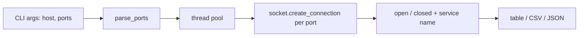

# port-scanner-lite

A small, readable TCP connect scanner written in Python with only the standard library. It defaults to **localhost**, maps ports to service names, and outputs a table, CSV, or JSON.

> **Authorized use only.** Scan only systems you own or have explicit written permission to test. By default this tool targets `127.0.0.1`; any other host requires the `--i-am-authorized` flag. Unauthorized scanning may be illegal.

## Problem
Quick checks of "what is listening on this machine?" are a daily admin task. This shows how a basic scanner works without heavy tools.

## How it works


## Setup
```bash
python3 -m venv .venv && source .venv/bin/activate
pip install pytest
pytest
```

## Usage
```bash
python scanner.py                                  # localhost, ports 1-1024
python scanner.py --ports 22,80,443,8000-8100 --format json
python scanner.py --ports 1-1024 --format csv > results.csv
python scanner.py --host 192.0.2.5 --ports 22,80 --i-am-authorized   # only if permitted
```

## Sample output
```
127.0.0.1:22     open    ssh
127.0.0.1:631    open    ipp
```
(Results depend on what is running on your machine.)

## Limitations
- TCP connect scan only (no SYN/UDP scanning, no banner grabbing, no OS detection).
- Service names come from the OS services database and are guesses based on port number, not on what is actually running.

## What it demonstrates
Socket programming, concurrency with a thread pool, input validation, safe-by-default CLI design, and testing network code against local listeners.

## License
MIT
